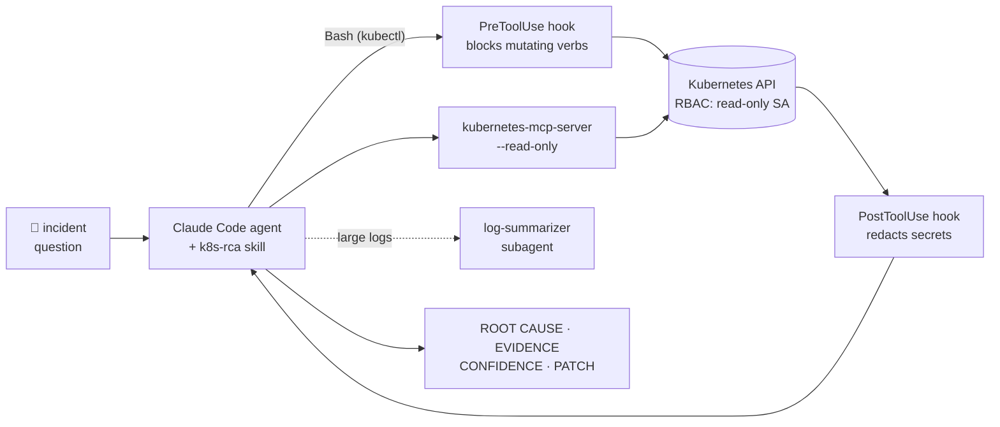

<!-- ===== HEADER ===== -->

<!-- ===== TYPING ANIMATION ===== -->

[)](https://git.io/typing-svg)

---

## 🧠 About Me

- 🎓 **Computer Engineering** student at **Amirkabir University of Technology** (Polytechnic Tehran) — GPA **4.00/4.00**
- 💻 **Backend engineer** building scalable systems with **Django**, **DRF**, **Celery** and **PostgreSQL**
- ☸️ Now working across the stack below the app too: **Kubernetes**, **Docker**, **CI/CD** and **observability** (Prometheus, VictoriaMetrics, Grafana)
- 🤖 Building **AI agents for operations**: a read-only **Kubernetes root-cause-analysis agent** built on **MCP**, hooks and skills
- 🛡️ Into **security** and CTFs: web exploitation, container escapes and Kubernetes attack paths
- 🔬 Also work with **Computer Vision** and **Deep Learning** (YOLO, OpenCV, PyTorch) and **Data Analysis**
- 🚀 Interested in **research lab**
- 📫 Reach me: **amirmahdigolahmar@gmail.com** · **amir.golahmar@aut.ac.ir**

---

## 🛠 Tech Stack

**Backend & APIs**

  
  
  

**Cloud Native & DevOps**

  
  
  

**Observability**

  
  

**AI Agents & LLM Tooling**

  
  
  

**Databases**

  

**Languages & AI / Data**

  
  
  
  

> **Also:** OOP · Data Structures · Algorithms · Relational Database Design · Django ORM · Kubernetes RBAC · Container Networking · Machine Learning · Deep Learning · Linear Algebra, Probability & Statistics

---

## 🚀 Featured Projects

### ☸️ Kubernetes App Platform — [`k8s-api`](https://github.com/AmirmahdiGolahmar/k8s-api) + [`k8s-api-frontend`](https://github.com/AmirmahdiGolahmar/k8s-api-frontend) · [🌐 live](https://golahmar.osdl.ir)

A self-service platform that turns "give me an nginx in a namespace" into a two-click operation instead of a `kubectl apply`.

- Register a cluster's kubeconfig, then create **namespaces** and **apps** (Deployment + Service) from a web UI or REST API
- Ownership and per-user access control on clusters, namespaces and apps
- **Pod file backups** on demand or on a cron schedule with **Celery + Celery Beat**
- Own **observability stack**: `/metrics` via django-prometheus, scraped by **VictoriaMetrics**, dashboards in **Grafana**
- Shipped with **GitHub Actions → GHCR**, deployed with raw manifests behind a **Traefik** Ingress

`Django` · `DRF` · `kubernetes-client` · `Celery` · `Redis` · `React` · `Ant Design` · `Docker` · `Kubernetes` · `VictoriaMetrics` · `Grafana`

### 🤖 Kubernetes RCA Agent — [`rca-k8s`](https://github.com/AmirmahdiGolahmar/rca-k8s)

An AI agent that finds the **root cause** of broken workloads in a Kubernetes namespace, built safe by design: it can look at everything and change nothing.

- **Defense in depth:** RBAC-scoped read-only ServiceAccount, read-only MCP tool surface, a hook that blocks `kubectl apply/delete/exec/...`, and a hook that redacts secrets from every tool output
- **Fixed diagnostic order** enforced by a skill (pods → events → describe → logs → YAML → endpoints) before any hypothesis
- **Failure-injection testbed** with reproducible scenarios: missing env var, label mismatch, renamed ConfigMap key, NetworkPolicy blocking the DB, failing readiness probe, broken DNS
- Unit tests for the hooks and the MCP handshake

`Claude Code` · `MCP` · `Hooks` · `Skills` · `Subagents` · `Kubernetes RBAC` · `Python`

### 🛡️ Ham CTF Write-ups — [`hamctf-writeups`](https://github.com/AmirmahdiGolahmar/hamctf-writeups/tree/add-AmirmahdiGolahmar-writeups/AmirmahdiGolahmar)

11 flags solved end to end, from web bugs to full host compromise, each with a reproducible PoC and a single `extract.sh` that replays them all:

`Docker layer forensics` → `API schema exposure` → `path traversal` → `broken access control` → `JWT alg confusion` → `command injection` → `SSRF into the cluster network` → `ServiceAccount token leak` → `privileged pod + hostPath escape` → `Docker socket escape to the host`

### 🚗 ZipDepth as a YOLO26n Backbone — [`zipdepth_yolo26n`](https://github.com/AmirmahdiGolahmar/zipdepth_yolo26n)

Research experiment: *can features learned for monocular depth estimation replace a detection backbone?* Swapped YOLO26n's backbone for the depth-pretrained ZipDepth encoder with channel adapters, fine-tuned on **KITTI**, and ran controlled ablations (adapter depth, neck/head init, longer training).

- Best ZipDepth variant reached **0.531** vs **0.602** mAP50-95 for the original, at 3.4× the parameters
- Deeper adapters helped most; depth pretraining gave **no** advantage on small, distant objects
- Full write-up with per-class AP, confusion matrices and PCA feature maps

`PyTorch` · `Ultralytics` · `KITTI` · `Colab T4`

### 📦 Earlier work

| Project | Description | Stack |
|---|---|---|
| **Dynamic Form Management** | Scalable backend for dynamic workflow & form management with GraphQL APIs, async pipelines (Celery/Redis), and production deploy (Gunicorn/Nginx) | Django · DRF · Graphene · PostgreSQL · Docker |
| [**Iranian_HEIS**](https://github.com/AmirmahdiGolahmar/Iranian_HEIS) | National household income/expenditure analysis with clustering (K-Means) & data visualization | pandas · NumPy · scikit-learn |
| [**Plate Recognition**](https://github.com/ZeinabMoayeri/Plate_recognition) | Iranian license-plate detection pipeline with image preprocessing & bounding-box extraction | Python · OpenCV · Pillow |

---

## 📊 GitHub Stats

---

## 🌐 Connect With Me

<!-- ===== FOOTER ===== -->

